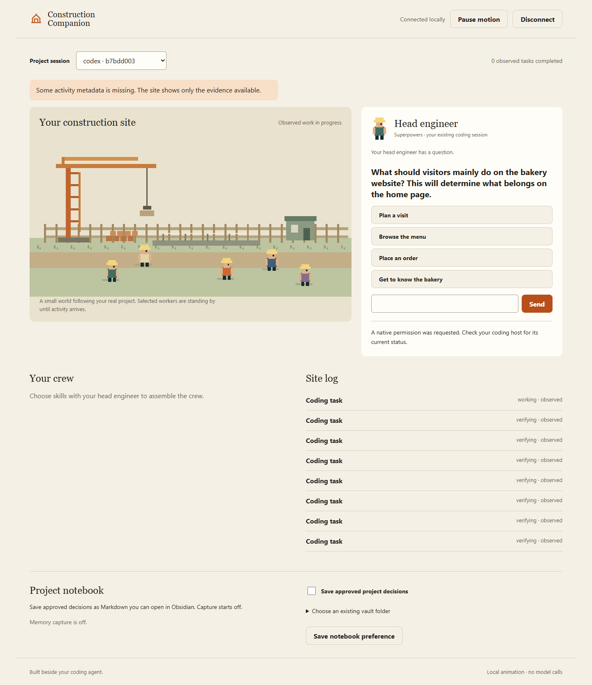

# Construction Companion

A tiny construction site beside your coding agent. You are the project owner; Superpowers guides the conversation as head engineer, and selected skills become your crew.

**V2 for Codex CLI on Windows.** The native workflow has been exercised with Codex CLI **0.155.1**: an ordinary website prompt reached genuine Superpowers, a browser answer returned to the same turn, skill choices worked, and interrupted or expired questions stayed safe. Other Codex versions/platforms and Claude Code use native-chat fallback until separately verified. This is a local companion, not a replacement coding agent or a verified Codex desktop extension.

The companion makes no model API calls. Your coding host still runs the work and uses its normal subscription or API allowance. Selected workers are not independent models. Pixel animation uses local Canvas drawing.

[Watch the captioned tutorial](https://github.com/JaiReyes45/construction-companion/releases/download/v0.1.0-preview.1/construction-companion-v2-tutorial.mp4) · [Preview downloads](https://github.com/JaiReyes45/construction-companion/releases/tag/v0.1.0-preview.1)



## Install from source

For a guided local demonstration after installing dependencies, run `node scripts/demo.mjs --copy-token`. Open its URL and paste the copied token. The page visibly labels simulated questions and activity. Ctrl+C stops the demo. This path makes no coding-agent or model request.

Prerequisites: Node.js 22.13 or newer (22.16 tested), npm, Git, and your chosen coding host. Install genuine [Superpowers](https://github.com/obra/superpowers) through that host if you want it to guide the workflow. Obsidian is optional.

```sh
git clone https://github.com/JaiReyes45/construction-companion.git
cd construction-companion
npm ci --ignore-scripts
node scripts/build-packages.mjs
node bin/construction-companion.mjs install --host codex --project "/absolute/path/to/your/project"
```

Read the setup preview, then repeat the final command with `--apply`. This registers the package in Codex's cache, leaves its user-wide entry disabled, and enables it only in the selected project. Review project and hook trust in Codex. Start Codex in that project with `codex --enable hooks`.

```sh
node bin/construction-companion.mjs start --project "/absolute/path/to/your/project"
node bin/construction-companion.mjs connect --project "/absolute/path/to/your/project" --copy-token
```

Open the printed local URL. Paste the copied token into **Local connection token**, then choose **Connect**. Keep the terminal/source checkout available. Continue prompting your coding agent as usual. The site displays activity supplied by its enabled hooks; unsupported questions stay in native chat.

Windows paths with spaces work when quoted. This package is not published on npm; there is no supported `npx construction-companion` installation.

## Use it

1. Tell the coding host what you want to build, for example a website for a local business.
2. Superpowers asks discovery questions beside the head engineer. Answer within 45 seconds; if you need longer, the question returns once to native chat. Unsupported hosts keep questions there.
3. Configure your installed skill collections using `configure --skill-root "<collection folder>"`, then restart the runner. The head engineer can recommend up to three skills for a role. Choose an installed skill, review a proposed installation, choose another, or continue without one.
4. Selected skills stand ready. Observed task activity drives the site; selected or agent-declared activity is not proof of a completed task.
5. Optionally enable **Project notebook** to save approved decisions as project-scoped Markdown. You can open the folder in Obsidian. Full chat transcripts are not copied.

Native command permissions always stay in your coding host. Third-party skills are never installed simply because a recommendation appears. The UI/UX Pro Max catalog entry currently links to manual upstream setup; no automatic recipe is enabled.

## Guides

- [Codex setup](docs/quickstart-codex.md) · [Claude setup and limits](docs/quickstart-claude.md)
- [Compatibility and evidence](docs/compatibility.md) · [Acceptance checklist](docs/acceptance.md)
- [Tutorial](docs/tutorial.md) · [Architecture](docs/architecture.md)
- [Privacy and permissions](docs/privacy-and-permissions.md) · [Removal and recovery](docs/uninstall.md)

## Development

```sh
npm test
node scripts/release-check.mjs
```

Tests use temporary folders, local loopback servers, Windows junction fixtures and child Node processes. Allow those in your development sandbox. The package-copy test is intentionally slower: it starts MCP tools from independent copied directories.

Native verification details and remaining limits are recorded in [compatibility](docs/compatibility.md).

MIT code; original CC0 pixel sprites. See [third-party notices](THIRD_PARTY_NOTICES.md). The [preserved V1 CRM prototype](https://github.com/JaiReyes45/AI-Automation-BasicProjects/tree/construction-crm-v1-prototype-verified/prototypes/construction-crm-v1) remains separate.
