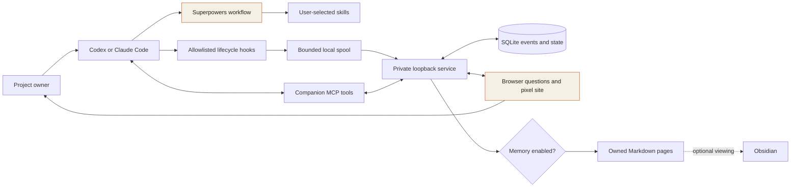
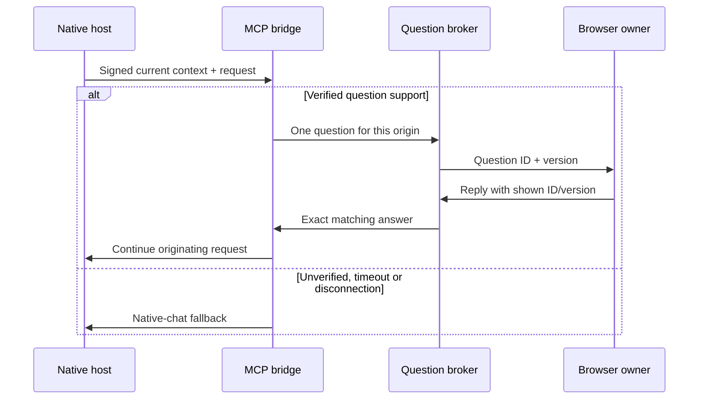
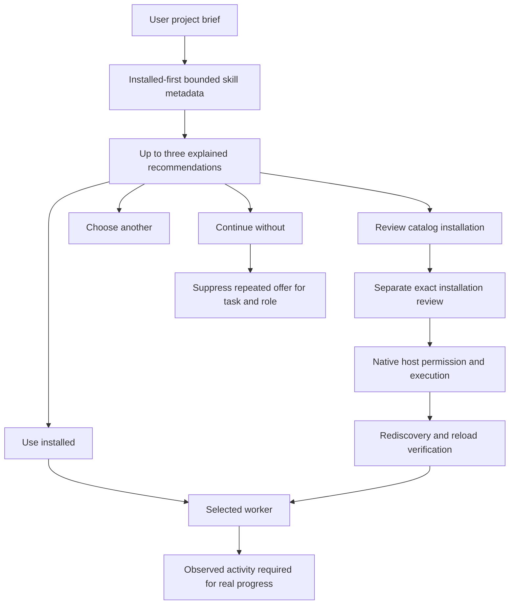

# Architecture

The existing coding host owns planning and execution. The companion is a local presentation and question-routing layer.

The broker keys questions by project, host, session, turn and MCP request. The browser uses opaque session handles and cannot supply a different origin. Selected/declarative state stays separate from observed events. Native permission requests never become game approval buttons.

Public lead intake and HubSpot/GHL belong to the preserved V1 CRM prototype. V2 has no CRM credential or account dependency.
