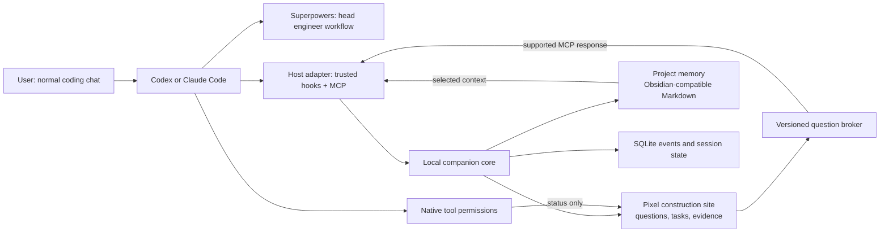

# Construction Companion V2 — approved design

Status: approved by the owner on 7 November 2026, including the explicit skill-recommendation amendment below. No V2 runtime, host hooks, global settings or user vault has been created or changed. Working name: Construction Companion. The owner selected the companion-plugin approach and can change this name before public repository creation.

## What the user asked for

A game-like way to communicate with an existing coding agent. The user keeps prompting Codex or Claude Code in their normal environment. Superpowers appears as the head engineer and asks the right questions about the project. Other skill activity appears as the construction crew. Obsidian supplies the project's memory. This is a general project-building product; the CRM is an example project rather than a required backend.

This clarification removes the need for an independently operating eight-to-ten-agent workforce. An extra model session is not created merely to give a skill a character. Native subagents, if the host actually starts them, are shown as separate actors with their real identity and state.

## The user journey

1. Install the appropriate Codex or Claude Code plugin, run its doctor, review the requested hook/file access, and choose a project folder. A shared local core supports both host packages. No HubSpot, n8n, Docker or account key is required for the companion itself.
2. Start the site for this project. In the normal coding chat, ask to build something. After the host-approved hooks and relevant skill activate, the head engineer appears at the site.
3. Superpowers guides discovery and planning in the main coding session. Each question appears as an engineer speech bubble with a readable card. The user can answer through a supported game question flow or use the normal chat fallback.
4. Each question belongs to exactly one host session/turn and has a stable ID. One accepted answer resolves it. An interrupt, timeout or disconnected session leaves an explicit cancelled/waiting state, not a guessed answer.
5. Approved decisions become the project brief and decision notes. The host reads a short index plus relevant memory pages. The full vault is not injected on each prompt.
6. The host performs its normal planning, implementation and verification workflows. Visible crew roles and skill badges reflect declared or observed evidence. Decorative movement adds no model calls.
7. Tool permissions are decided through the native host's approval mechanism. The game can explain the request and show its state; it never converts a question answer into an execution permission.
8. The completed project has code, decisions and an inspectable construction history. The owner can pause the companion, export their project notes, or uninstall it without losing code or memory.

## Architecture

### Host packages

A shared Node runtime and core contracts, with separate tested Codex and Claude Code manifests and adapters. The proposed source distribution contains a portable plugin manifest plus host-specific compatibility files, skills, MCP configuration, hook scripts and original pixel assets. Exact generated files depend on each host's supported format and version; they are not assumed interchangeable.

Official documentation provides plugin packaging and lifecycle hooks for [Codex](https://developers.openai.com/plugins/build/plugins) and [Claude Code](https://code.claude.com/docs/en/plugins). Both document prompt/tool/subagent lifecycle hooks, but inputs, trust and supported surfaces require separate adapters: [Codex hooks](https://learn.chatgpt.com/docs/hooks), [Claude Code hooks](https://code.claude.com/docs/en/hooks). The installed Codex CLI is0.155.1. Claude Code was not found on the current shell PATH, so Claude compatibility is a release gate, not a verified result.

Do not promise installation on every IDE merely because it supports MCP. The onboarding doctor must identify host/version, supported hooks, question support and installed workflow dependencies. An unsupported surface shows a specific limitation and a manual-start fallback. No undocumented desktop-chat attachment, transcript scraping or simulated keyboard input is used.

### Head engineer and crew

Superpowers remains the main agent's workflow instruction set. Reuse the user's installed package through a verified host integration; detect absence and provide setup instructions. Do not silently vendor or relabel a curated package as this project's own source. Check the upstream license and provenance before any redistribution.

A crew member is a presentation identity for a role/skill/task, with links to the skill package and evidence. States distinguish selected, declared active, observed working, waiting for an answer, waiting for native permission, verifying, completed, failed and unknown. A selected skill is not proof it ran. A worker note is not an independent thinking process.

### Skill recommendations and user choice — approved amendment

The head engineer can recommend skills for the user's stated goal, explain why each fits, and suggest a crew role. Example: for a website, propose UI/UX Pro Max as the architect for layout, typography, accessibility and visual design.

The recommendation card shows purpose, suggested role, installed/available status, source, version/revision, license and any prerequisites. The user can use an installed skill, review/request installation of an optional skill, choose another installed or verified catalog entry, or continue without an extra skill. Declining is a normal successful path and is remembered for the current task; it must not trigger repeated install prompts.

Prefer relevant installed skills before new downloads. Recommendations use the existing coding agent's reasoning plus bounded inventory/catalog metadata; the companion does not call another model to rank skills. Catalog text and remote skill instructions do not authorize installation.

Selecting a role, installing a package and activating a skill are separate states. A request to install creates a concrete host installation intent showing source/revision, destination, scope, prerequisites and expected files. It is carried out through the native host's reviewed installation workflow. The web UI does not run arbitrary installation commands or bypass host permission checks. Unavailable, failed or reload-required installation stays explicit; no worker is shown as executing that skill until the installed/active evidence exists.

Bindings belong to this project/task. The installer uses the narrowest host-supported activation scope and explains when storage or configuration is user-wide. It never silently replaces an installed version, grants access in other projects, or treats approval of one skill as approval of future skills. A changed source, revision, destination or scope invalidates the prior install intent.

On consented memory capture, save the selected role/skill/version and the user's reason in project decisions and the worker's notes. Choosing a different architect changes the assignment; it does not uninstall unrelated user packages. The website -> architect recommendation -> accept/alternate/decline flow is a required release scenario.

### Local core and state

The core owns project/session identity, event ingestion, projection, question state and memory access. It exposes a local MCP server and an authenticated loopback-only web view. Hooks write bounded metadata to a local spool and return promptly; a stopped renderer must not freeze a coding session. Execution stays in the host's native tools and sandbox.

An event includes host, adapter/runtime version, project/session/turn IDs, event ID, source sequence/time, type, evidence level, actor/task/skill references when present and a sanitized payload. Reconnects deduplicate and replay. Missing evidence stays unknown. No model reasoning is captured.

The game follows authoritative events; its animation never fabricates completion. SQLite stores execution/question state. Project Markdown stores readable knowledge. Neither silently substitutes for the other's authority.

### Questions

Default to one active discovery question per project session. Store question text/options, source, version and status. A supported MCP question call waits for the user's reply within a bounded timeout; the answer returns only to the originating request. Version checks prevent double replies. A host interruption cancels the pending call.

Use the native chat as the fallback if the host cannot complete a game-side question interaction. Do not promise to mirror every native host question or answer without a supported API. Native permission requests remain a separate channel and cannot be approved by this question broker.

### Obsidian memory

Proposed default: a dedicated project vault, with an explicit option to select a folder inside an existing vault. Obsidian itself is optional for reading/editing the portable Markdown files. If an installed Obsidian skill or supported CLI is present, integrate through its documented interface.

Suggested pages: Project Brief, Decisions, Open Questions, Artifacts, and Workers/Head Engineer, Architect, Builder and Inspector. Worker pages hold scoped decisions, learned project facts and artifact links. They do not copy the whole conversation or raw chain of thought.

The user reviews memory capture during onboarding. Prompt bodies are not logged by default. Writes stay inside the selected vault, reject link/path escapes, preserve user-owned content, use version/atomic-write safeguards and surface conflicts. Notes are treated as untrusted context, not executable instructions or new permissions. Read a compact index and selected pages to keep context costs visible and bounded.

## What can carry over from V1

Keep the original CC0 sprites and approved warm-paper/dark-ink/construction-orange design. Reuse deterministic projection, replay, event validation, accessibility patterns and evidence/approval semantics where suitable. Generalize their contracts in the separate V2 codebase after the design is approved.

V1's launch-owning scheduler is not the default execution owner for the companion. The coding host owns the session. The CRM-specific service, HubSpot/GHL configuration and Docker stack remain in the V1 archive and optional example material.

## Open-source delivery

Proposed new repository: construction-companion, separate from the preserved V1 prototype. Proposed license: MIT for newly authored code; retain CC0 sprite credit and any applicable third-party notices. Superpowers and Obsidian-related packages need their own verified licenses; the plugin does not redistribute coding models or the Obsidian app.

A user-ready release includes a real installer/uninstaller with reversible configuration changes, host-specific quickstarts, doctor output, a sample project, a captioned walkthrough, clear permission/memory controls and a compatibility matrix. Proposed CLI names in later plans are placeholders until a package name is checked and published.

No hidden cloud service or plugin-owned model key is required for the default workflow. Host/model usage may still be billable. No extra model call is made for animation, event routing or basic memory indexing. Host workflows can still use models/subagents according to the user's normal configuration.

## Implementation order after approval

1. Verify installed host schemas/trust behavior and prove one harmless event reaches a small companion fixture in each host.
2. Build the shared event/session core and offline deterministic renderer integration.
3. Add the Superpowers head-engineer entry workflow and versioned question bridge, including native-chat fallback and interrupt handling.
4. Add scoped project Markdown memory with explicit capture settings, conflict handling and selective reads.
5. Package the Codex and Claude Code adapters, installers, sample project and uninstall/recovery paths.
6. Run native-host acceptance, accessibility, privacy and recovery checks; then prepare the open-source release for owner review.

## Acceptance gates

- A normal build prompt can activate the opted-in companion in each claimed host/version, without launching an independent orchestration model.
- Website requests can receive an explained architect-skill recommendation; accept, alternate, decline and installation/reload states all work without silently changing the host.
- A real Superpowers discovery question reaches the game; one answer returns to the correct request; duplicate/late answers and interrupted sessions behave correctly.
- Native tool approvals retain native authority and current sandbox/trust policy.
- A project can resume using selected Markdown decisions without ingesting unrelated vault data or full transcripts.
- Event replay and reconnect produce the same scene. Failure or cancellation cannot complete construction.
- Disabling/removing the companion preserves the coding environment, project and notes.
- Actual clean installs pass on the claimed platforms. Fixture tests do not establish native Claude/Codex support by themselves.
- UI supports keyboard use, reduced motion, readable text alternatives and a clear offline state.
- Animation and routing produce zero model calls; actual host usage is measured where available and unknown otherwise.

## Reference-video evidence and remaining uncertainty

[Requested Facebook video](https://www.facebook.com/share/v/1Lz2igdGWU/) resolves to [reel1428110866105172](https://www.facebook.com/reel/1428110866105172), by Joshua Ladero. Agent Reach retrieved its public caption describing Claude Code, Pixel Agents and Obsidian. A public browser frame showed Step2: creating an Obsidian vault. The player later displayed a sign-in prompt; no complete footage/audio transcript was obtained. This design is grounded in the owner's clarification and verified host documentation, not a claimed reverse engineering of the creator's backend.

The full video review remains open until the owner signs in on the official page or supplies the video. No login is performed on the owner's behalf. No O2San/Pixel Agents artwork or code is copied.

## Approval record

The owner approved the companion design and added user-controlled skill recommendations. Accepted direction: the existing host remains the execution owner; Superpowers is the head engineer; worker memory uses a project-scoped Obsidian-compatible vault; game questions use supported host/MCP paths with native-chat fallback; native approvals stay native; V2 is a separate open-source project.

## Engineering defaults proposed by the implementation plan

These are implementation choices for review, rather than additional claims about what the owner or video specified.

- Runtime: Node.js >=22.13.0, ESM JavaScript with JSDoc types, built-in HTTP, SQLite and node:test; initially verify on Node.js 22.16.0. Pin @modelcontextprotocol/sdk 1.32.2 and zod 4.6.7 with a committed lockfile when implementation begins.
- The existing coding host owns execution. The companion creates no model session or model API request.
- V2 lives in its own construction-companion repository. V1 source, services, history and public prototype tags are preserved.
- Default service binding is 127.0.0.1 on an OS-assigned port; no LAN binding. Use separate random 256-bit ingest and browser tokens, private per-user storage outside the repository and OneDrive, and explicit browser connection. Do not put tokens in URLs, logs or committed configuration.
- Each session is keyed by projectId, host and sessionId; turnId and requestId further scope interactive calls. An external ID is opaque and is never used as a filesystem path.
- Event payload limit is 16 KiB encoded UTF-8. HTTP request limit is 64 KiB. Return at most 100 events and at most 768 KiB per replay page. The local metadata spool is capped at 5 MiB; overflow produces an explicit history-gap marker.
- One active discovery question per session. Text is limited to 4,000 characters, choices to six, and replies to 16 KiB UTF-8. A question is not a native execution permission. A fresh question version is required after editing or replacement.
- Question wait defaults to 45 seconds with a single native-chat fallback on timeout. A maximum of 600 seconds is available only for a host/version with a recorded successful long-wait probe; no automatic wait/retry loop. Cancellation and disconnect end the pending wait explicitly.
- Skill recommendations come from the current host agent, using at most 20 relevant metadata entries; show at most three candidates per role. Selection, installation and evidence of actual activity remain separate states.
- Installation intents expire after 10 minutes and bind source, revision, destination, scope and expected files by digest. The native coding host reviews and performs the installation. The browser cannot execute commands. Changing any bound field creates a new intent.
- Project/task skill bindings do not grant global activation. A user's decline suppresses another recommendation for the same role and task unless the user reopens the choice.
- Memory capture starts disabled. Default memory is a dedicated private project folder; selecting an existing vault requires an explicit path choice. Read at most six selected pages and 8 KiB UTF-8 of context per call, including the index and truncation notices. Do not record raw reasoning or prompt bodies by default.
- SQLite is authoritative for session/question/event state. Markdown is authoritative for editable project knowledge. Markdown conflicts remain visible for review and do not roll back an accepted answer.
- User-ready compatibility requires native-host evidence on every advertised host/version/platform. Fixture tests alone do not qualify a host. Unsupported or unverified capabilities are labelled explicitly.
